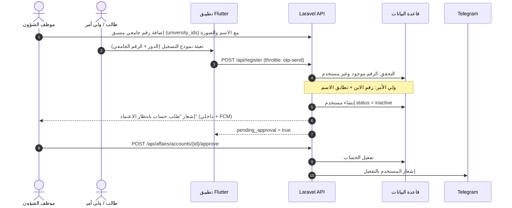
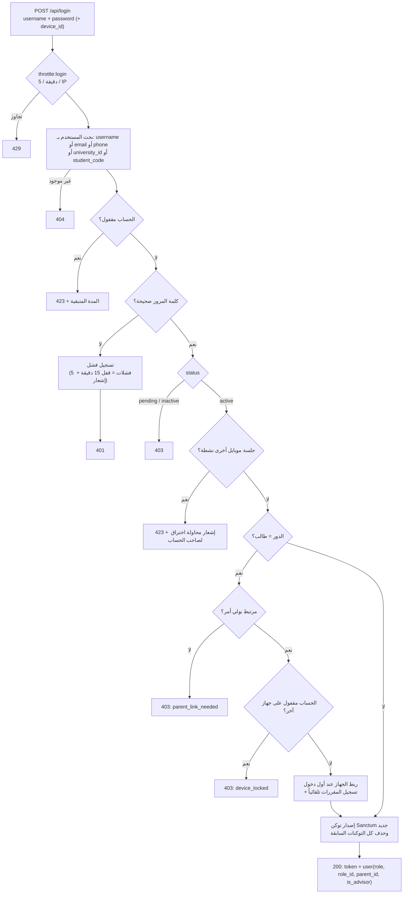
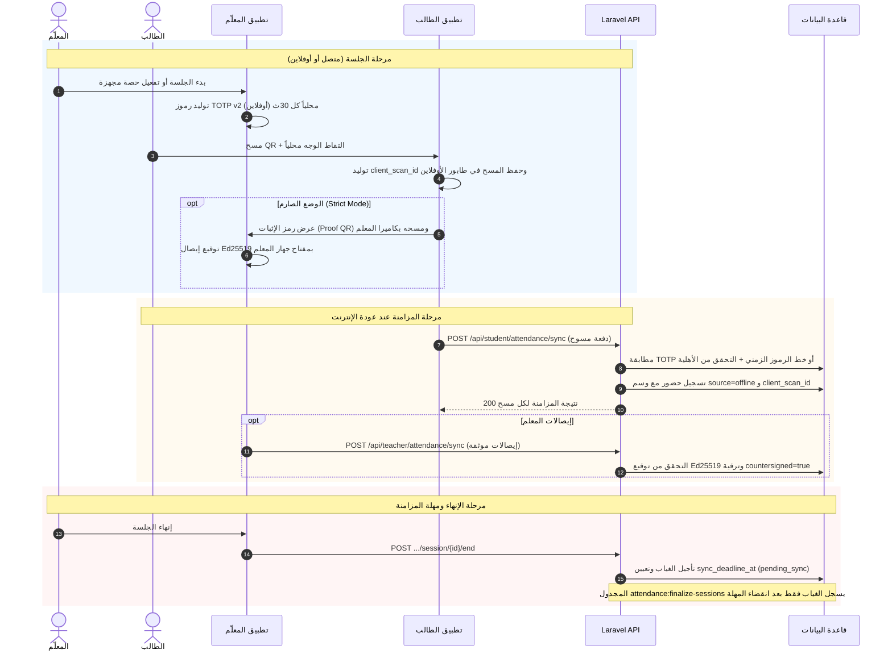
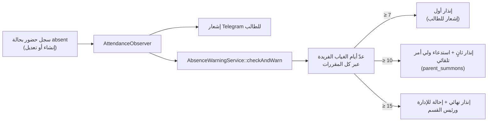
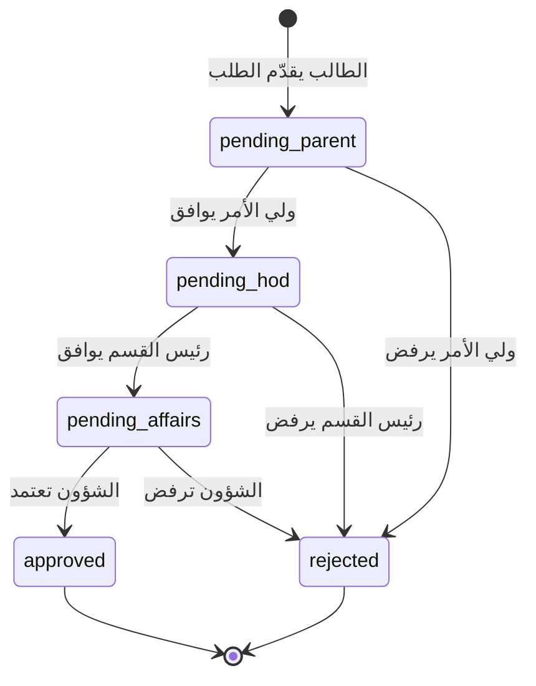
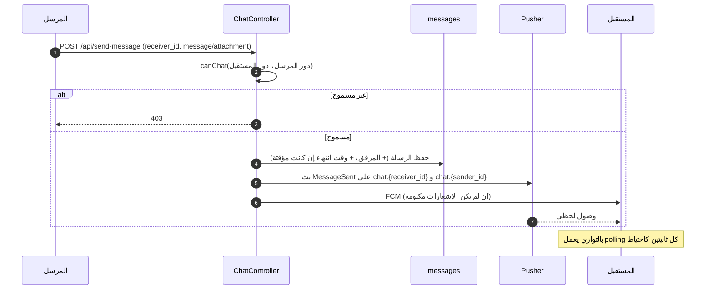
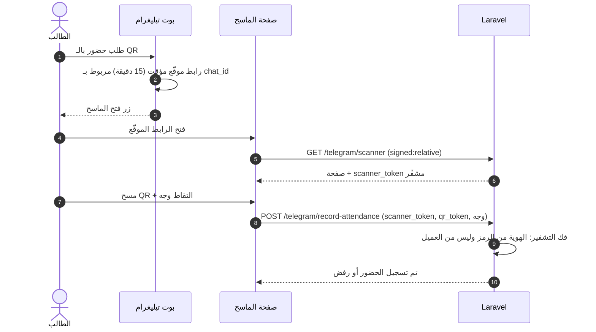

# التدفقات الرئيسية

المخططات بصيغة Mermaid (تُرسم تلقائياً في GitHub وموقع التوثيق). كل تدفق مبني على الكود الفعلي، مع ذكر الملف.

## 1) إنشاء الحساب والتفعيل

الحسابات الذاتية للطلاب وأولياء الأمور تمر بمراجعة الشؤون. (المصدر: `Api\AuthController::register`, `AffairsController::approveAccount`)

## 2) تسجيل الدخول (API)

(المصدر: `Api\AuthController::login`, `SingleSessionGuard`, `LoginThrottleGuard`)

بدائل الدخول: **OTP عبر البريد** (`/login-otp/send` ثم `/login-otp/verify`)، وللويب صفحة دخول لكل دور مع **التحقق بالوجه** للطالب عند الدخول من أجهزة متعددة.

## 3) تسجيل الحضور (المتصل + الأوفلاين الكامل)

(المصدر: `Api\TeacherController`, `Api\StudentController`, `Support\QrTokens`, `Support\TotpQrService`, `Services\AttendanceSessionFinalizer`, `Services\TeacherReceiptService`)

يدعم النظام نمطين متكاملين لتسجيل الحضور:
1. **المسار المتصل (Online):** تدوير الرموز دورياً والتحقق الفوري.
2. **المسار غير المتصل الشامل (Full Offline Attendance - الفكرة 8):**
   - **المعلم أوفلاين:** توليد رموز TOTP محلياً كل 30 ثانية عبر `TotpQrService` (خوارزمية `HMAC-SHA256` مع تسامح زمني `±1`)، وجلب الحصص المجهزة لليوم عبر `GET /api/teacher/attendance/today-sessions`.
   - **الخط الزمني للرموز:** حفظ السجل الزمني الكامل في `attendance_session_tokens` لمنع رفض مسوح الطلاب القديمة (حل مشكلة P1).
   - **منع التكرار (Idempotency):** اعتماد `client_scan_id` فريد لكل مسح لمنع تكرار السجلات أو التعارضات عند إعادة المحاولة.
   - **مزامنة الدفعات:** نقطة `POST /api/student/attendance/sync` لمعالجة حتى 20 مسحاً دفعة واحدة عند استعادة الاتصال.
   - **تأجيل الغياب (Grace Window):** عند إنهاء الجلسة الأوفلاين (`offline_mode != none`)، يتم وسمها بحالة `pending_sync` وتحديد مهلة `sync_deadline_at` دون إنشاء غياب فوري (حماية الطلاب من الإنذارات الخاطئة P3). ويقوم الأمر المجدول `attendance:finalize-sessions` بتسجيل الغياب تلقائياً فقط بعد انقضاء المهلة.
   - **الوضع الصارم الاختياري (Strict Mode - Ed25519):** بعد المسح يعرض الطالب رمز إثبات (`edu-bridge://proof?scan_id=...`)، ويقوم المعلم بمسحه وتوقيع إيصال محلياً بمفتاح جهازه Ed25519، ورفعه عبر `POST /api/teacher/attendance/sync` لترقية مستوى الثقة إلى `countersigned = true` و`time_confidence = high`.

أسباب الرفض (`reject_reason`): `expired_qr`, `sync_timeout`, `lesson_not_found`, `device_mismatch`, `location_too_far`, `face_mismatch`, `bad_offline_token`, `bad_receipt`، بالإضافة لأسباب الأهلية وتكرار التسجيل.

## 4) الإنذارات التلقائية للغياب

(المصدر: `AttendanceObserver`, `Services\AbsenceWarningService`)

كل مستوى يُصدر **مرة واحدة** لكل طالب (`student_warnings`). انظر ملاحظة B-07 في حالة المشروع.

## 5) طلب الإجازة

(المصدر: `StudentController::requestAbsence` ← `StudentParentController::respondLeaveRequest` ← `Api\DepartmentHeadController::respondLeaveRequest` ← `AffairsController::updateLeaveStatus`)

> كل طلبات الإجازة في `leave_requests` وتمر عبر مسار واحد (`LeaveWorkflow`) للويب وتطبيق Flutter والبوت. جدول `absence_requests` القديم نُسخ إليه ثم حُذف.

## 6) الدردشة

مصفوفة من يراسل من:

| المرسل | يستطيع مراسلة |
|---|---|
| الطالب | رئيس القسم، المعلّم، الإدارة |
| المعلّم | المعلّمين، الطلاب، رئيس القسم |
| ولي الأمر | الإدارة، رئيس القسم |
| رئيس القسم | ولي الأمر، المعلّم، الطالب، الإدارة |
| الإدارة | رئيس القسم، الشؤون، المعلّم، الطالب |
| الشؤون | الإدارة |

## 7) استعادة كلمة المرور

- **API:** `forgot-password` يرسل OTP، ثم `reset-password` (بالبريد + الرمز + كلمة جديدة).
- **ويب:** عبر Telegram: `send-otp` ← `verify-otp` (5 محاولات كحد أقصى) ← `reset`، والرمز محفوظ في جلسة المتصفح وصالح 15 دقيقة.

## 8) ماسح تيليغرام

(المصدر: `TelegramBotHandler::handleQrAttendanceMenu`, `TelegramWebhookController`)

الحالات: `verified` عند مطابقة وجه 70% فأكثر، `first_time` عند أول بصمة، `suspicious` عند غياب بيانات وجه أو تطابق ضعيف (مع تنبيه المعلّم). ويمكن اشتراط الوجه بـ `ATTENDANCE_REQUIRE_FACE=true`.
